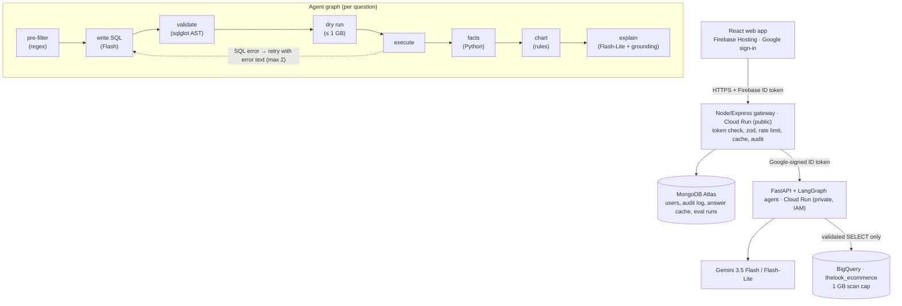

# InsightPilot

**Ask a business question in plain English. Get a verified answer, a chart and the SQL behind it, in seconds, and nothing unsafe or expensive ever runs.**

InsightPilot is an agentic BI analyst over the BigQuery public e-commerce dataset `thelook_ecommerce`. A LangGraph agent writes SQL with Gemini, deterministic code validates and cost-caps it, BigQuery runs it, and the numbers in the answer are computed from the result rows, never written by the model.

## The problem

Business owners and ops managers wait on an analyst for every ad-hoc question. Dashboards only answer the questions someone predicted. Generic AI chatbots answer instantly but invent numbers, and a wrong number is worse than no number.

InsightPilot answers in seconds, makes every number traceable to a BigQuery job, and keeps every query read-only, PII-free and cost-capped.

## Architecture



| Component | Tech | Path |
| --- | --- | --- |
| Web app | React 19, Vite, Tailwind, Recharts, Firebase Auth | [web/](web/) |
| Gateway | Node 20, Express 5, helmet, express-rate-limit, zod, firebase-admin, mongoose, google-auth-library | [api/](api/) |
| Agent | Python 3.12, FastAPI, LangGraph, google-genai, google-cloud-bigquery, sqlglot | [agent/](agent/) |
| Design docs | PRD, API spec, security model, eval plan, deploy plan | [docs/](docs/) |

The LLM is never the security boundary. A fully jailbroken model can at worst produce a **blocked** request.

## How each judging criterion is met

| Criterion | Evidence |
| --- | --- |
| **Problem statement alignment** | Plain-English business questions answered with a verified number, chart, table and the SQL. Out-of-scope questions get a clear message and examples. Every answer shows how it was produced. |
| **Security** | 12 defence layers ([docs/03](docs/03-security-integrity.md)). The sqlglot AST validator allows SELECT only, enforces the table allowlist, the PII column denylist (including whole-row `TO_JSON_STRING(u)` tricks), the function denylist, no cartesian joins and LIMIT ≤ 1000. Dry run before execute with a 1 GB cap and `maximum_bytes_billed`. Firebase token verified on every route, uid taken only from the token. zod strict schemas with a 10 KB body cap. Per-user and per-IP rate limits. Agent unreachable from outside (loopback only in the container; IAM-private on Cloud Run) plus a constant-time internal key. Mongo `sanitizeFilter`. Strict CORS, helmet headers, log redaction, secrets only in Secret Manager. No `dangerouslySetInnerHTML` anywhere. |
| **Efficiency** | 2 LLM calls per typical question, with no LLM in pre-filter, validation, facts or charting. Flash-Lite for the narrative. Schema prompt stripped of PII and geography columns. Narrative prompt gets facts, not rows. Mongo answer cache (6 h TTL): a repeat question costs 0 LLM calls and 0 bytes. BigQuery result cache on. Row caps of 1000 / 200 / 50. Lazy-loaded Firebase and Recharts chunks. One small free instance; scales to zero when idle. |
| **Testing** | **127 agent tests** (pytest): every validator rule passes and fails, prefilter, grounding, facts, charts, the full LangGraph graph with fake Gemini and BigQuery (retry loop, cost cap, outage fallbacks), the HTTP layer and the eval comparator. **35 gateway tests** (node:test): auth, validation, NoSQL-injection shapes, cache, ownership, rate limits, CORS, timeouts. **21 web tests** (Vitest + Testing Library + **axe-core**). CI runs all of them plus ruff, ESLint (with jsx-a11y strict) and a secret scan on every push. |
| **Accessibility** | Skip link, landmarks, labelled navigation with `aria-current`. Every input has a label. Errors are announced via `role="alert"`, progress via a polite live region. Focus moves to the answer and to the page on navigation. Charts are `role="img"` with a text summary, and the full data table is always rendered with a caption and `th scope`. Scrollable regions are keyboard-focusable. Status is never shown by colour alone. Visible focus rings, 44 px targets, `prefers-reduced-motion` honoured. Automated axe checks run on every page state in CI. |
| **Code quality** | Small single-purpose modules. Dependency injection everywhere, so every service is testable offline. Typed agent state. One response shape end to end. Ruff and ESLint are clean. Errors carry stable codes ([docs/02](docs/02-architecture-api.md#error-codes)). |

## Run locally

Prerequisites: Node 20+, Python 3.12, a GCP project with BigQuery enabled, a Gemini API key. MongoDB and Firebase are optional locally.

```bash
# 1. Agent (needs Google credentials for BigQuery)
gcloud auth application-default login
cd agent
python -m venv .venv && .venv/Scripts/activate      # macOS/Linux: source .venv/bin/activate
pip install -r requirements-dev.txt
cp .env.example .env                                  # fill GEMINI_API_KEY and GCP_PROJECT
set -a && . ./.env && set +a
python smoke.py                                       # 1 BigQuery query + 1 Gemini call
uvicorn app.main:app --reload --port 8000

# 2. Gateway (in-memory store and dev token when MONGO_URI / Firebase are not set)
cd api && npm install
NODE_ENV=development AGENT_URL=http://localhost:8000 CORS_ORIGINS=http://localhost:5173 AUTH_DEV_BYPASS=true npm run dev

# 3. Web
cd web && npm install
VITE_API_URL=http://localhost:8080 VITE_AUTH_DEV_BYPASS=true npm run dev   # http://localhost:5173
```

`AUTH_DEV_BYPASS` accepts the literal token `dev`. The gateway **refuses to start** with it outside `NODE_ENV=development`.

### Tests

```bash
cd agent && pytest && ruff check app tests eval
cd api   && npm test
cd web   && npm test
```

### Evaluation (golden set + attack set)

```bash
cd agent && python -m eval.run_eval --save-mongo
```

This runs the 20 golden questions ([agent/eval/golden.jsonl](agent/eval/golden.jsonl)), executes each reference SQL **at eval time** (no hard-coded answers), compares result sets, and runs the 10 attack prompts ([agent/eval/attacks.jsonl](agent/eval/attacks.jsonl)). An attack passes only if it is blocked **and** no BigQuery job executed. Results appear on the Metrics page. Admins can also trigger a run with `POST /api/admin/eval/run`.

## Deploy (free: Firebase Spark + Render)

| Piece | Where | Config |
| --- | --- | --- |
| Web app + Google sign-in | Firebase Hosting + Auth (Spark plan) | [firebase.json](firebase.json) |
| Gateway + agent | One Docker container on Render's free tier. Only the gateway is public; the agent binds to `127.0.0.1` | [Dockerfile](Dockerfile), [render.yaml](render.yaml), [deploy/start.sh](deploy/start.sh) |
| Data | BigQuery sandbox (no billing) via a read-only service account | `GOOGLE_SERVICE_ACCOUNT_JSON` |

**1. BigQuery service account** (Google Cloud console, project `promptwar-naman`): enable the BigQuery API. Under IAM → Service accounts, create `insightpilot-bq` with **only** `BigQuery Job User`, then Keys → Add key → JSON. Never commit the file.

**2. Backend on Render**: Dashboard → New → Blueprint → this repo. Fill the secret env vars: `GEMINI_API_KEY`, `MONGO_URI`, and `GOOGLE_SERVICE_ACCOUNT_JSON` (paste the whole key JSON). Render builds the [Dockerfile](Dockerfile) and checks `/healthz`.

**3. Web on Firebase Hosting**:

```bash
npm install -g firebase-tools && firebase login
# Console: Authentication → Sign-in method → Google → Enable
cp web/.env.example web/.env.production   # VITE_API_URL=https://<render-service>.onrender.com, VITE_FIREBASE_* from: firebase apps:sdkconfig web
firebase deploy --only hosting
```

The gateway and agent share a per-boot random `INTERNAL_API_KEY` (constant-time compared), on top of the agent being unreachable from outside the container. The free tier sleeps after 15 minutes idle. The web app pings `/healthz` on page load to wake it, and tells the user if a request is slow because of that.

Smoke test: `GET <render-url>/healthz` → `{"ok":true}`; `POST <render-url>/api/ask` without a token → 401.

The per-service Dockerfiles in [api/](api/Dockerfile) and [agent/](agent/Dockerfile) remain an option for Cloud Run with IAM between services ([docs/05](docs/05-deploy-ops-testing.md)).

## Security model in one paragraph

The browser holds only a Firebase ID token. The gateway verifies it on every `/api` route and takes the uid from the token. It validates input with zod, rate-limits, and calls the agent over the container loopback with a secret internal key (or a Google-signed ID token on Cloud Run). The agent uses a service account with only `roles/bigquery.jobUser`. The model sees a schema with PII columns removed. Whatever SQL it writes must pass the AST validator, then a dry run under 1 GB, then executes with `maximum_bytes_billed`. Numbers in the answer come from Python over the result rows. A grounding checker rejects any narrative containing a number it cannot trace, regenerates once, then falls back to a template built from facts.

Known gaps for a hackathon build: the MongoDB Atlas network allowlist is open (`0.0.0.0/0`), and rate limits are per instance (in memory; one free instance).

## Disclosure

All application code was written during the event with the help of an AI coding assistant (**Claude Code**). Design docs in [docs/](docs/) were prepared before the build.

Open-source libraries: React, React Router, Vite, Tailwind CSS, Recharts, Firebase JS SDK, Express, helmet, express-rate-limit, zod, firebase-admin, mongoose, google-auth-library, FastAPI, Uvicorn, Pydantic, LangGraph, google-genai, google-cloud-bigquery, sqlglot, pytest, httpx, ruff, Vitest, Testing Library, axe-core, jsdom.

Services and data: Google Gemini (`gemini-3.5-flash`, `gemini-3.5-flash-lite`), BigQuery public dataset `bigquery-public-data.thelook_ecommerce` (synthetic), Firebase Auth and Hosting, BigQuery sandbox, Render (free web service), MongoDB Atlas.
