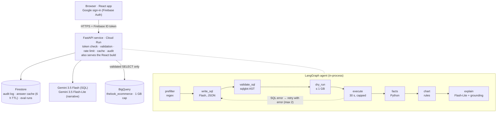

# InsightPilot

**Ask a business question in plain English. Get a verified answer, a chart and the SQL behind it in seconds, and nothing unsafe or expensive ever runs.**

## Problem

Business owners and ops managers wait on an analyst for every ad-hoc question ("which categories lost revenue last quarter?"). Dashboards only answer the questions someone predicted. Generic AI chatbots answer instantly but invent numbers, and a wrong number is worse than no number.

InsightPilot is an agentic BI analyst over the BigQuery public dataset `thelook_ecommerce`. A LangGraph agent writes SQL with Gemini. Deterministic code validates and cost-caps that SQL, then BigQuery runs it. **Every number in the answer is computed from the result rows, never written by the model**, and the SQL, BigQuery job ID and per-step trace are shown with every answer.

## Architecture



| Path | What |
| --- | --- |
| [agent/app/main.py](agent/app/main.py) | HTTP API: auth, validation, rate limit, cache, audit, serves the web app |
| [agent/app/graph.py](agent/app/graph.py) | LangGraph agent and trace |
| [agent/app/nodes/](agent/app/nodes/) | prefilter, write_sql, validate_sql, facts, chart, explain |
| [agent/app/security.py](agent/app/security.py) · [store.py](agent/app/store.py) | Token verification, rate limiter, headers, body cap · Firestore store |
| [agent/eval/](agent/eval/) | 20 golden questions, 10 attacks, `run_eval.py` |
| [web/](web/) | React 19 + Vite + Tailwind + Recharts: Ask, History, Metrics |
| [docs/](docs/) | PRD, API spec, security model, eval plan, build plan |

## Security

The LLM is treated as untrusted input. Every guarantee is enforced by deterministic code and IAM, so a fully jailbroken model can at worst produce a **blocked** request.

| Layer | Mechanism | Code |
| --- | --- | --- |
| Identity | Firebase ID token verified on every `/api` route (signature, expiry, audience). The uid comes only from the token. | `security.py`, `main.py: current_user` |
| Input | Pydantic: string only, 3–500 chars, control characters stripped, extra fields rejected (400). 10 KB body cap enforced at the ASGI layer, even without `Content-Length` (413). | `main.py: AskBody`, `security.py: BodySizeLimit` |
| Abuse | 10 asks/min and 100/day per user (429 + `Retry-After`). Cloud Run `--max-instances 3`. | `security.py: RateLimiter` |
| Pre-filter | Regex, no LLM: destructive SQL verbs, "ignore previous", "system prompt", personal-data asks → `UNSAFE_REQUEST`; poems, other datasets, `INFORMATION_SCHEMA` → `OUT_OF_SCOPE` | `nodes/prefilter.py` |
| LLM sandbox | The model sees only allowlisted tables with PII columns removed, and must return JSON `{answerable, sql, assumptions}` | `schema_cache.py`, `prompts/write_sql.v1.txt` |
| **SQL validator** | sqlglot AST (bigquery dialect): exactly one statement; SELECT / WITH / set-ops only; no DML, DDL or scripting node anywhere; tables must be in the `thelook_ecommerce` allowlist; no `INFORMATION_SCHEMA`; no PII columns (including via aliases, CTEs and whole-row `TO_JSON_STRING(u)`); no `SELECT *` over `users`/`events`; no `EXTERNAL_QUERY`, `ML.*`, `AI.*`; no cartesian joins; LIMIT added or lowered to 1000. Violations → `UNSAFE_SQL`, **never retried**. | `nodes/validate_sql.py` |
| Cost | Dry run first, blocked above 1 GB (`COST_LIMIT`). Execution with `maximum_bytes_billed`, 30 s timeout, label `app=insightpilot`. | `bq.py`, `graph.py` |
| Least privilege | The runtime service account has only `roles/bigquery.jobUser`, `roles/datastore.user` and `secretAccessor` on one secret. The dataset is public read-only anyway. | Deploy below |
| Secrets | Gemini key in Secret Manager. `.env*` git-ignored. The frontend bundle holds only the Firebase web config (public by design). CI fails on committed keys. | `.gitignore`, `.github/workflows/ci.yml` |
| Headers | CSP, `nosniff`, `X-Frame-Options: DENY`, HSTS, Referrer-Policy, Permissions-Policy. CORS is off by default (same origin) or locked to `CORS_ORIGINS`. | `security.py: SECURITY_HEADERS` |
| Output | React escapes everything; no `dangerouslySetInnerHTML` (ESLint `react/no-danger` = error). | `web/eslint.config.js` |
| Audit + logs | One Firestore record per request: uid, question, SQL, job ID, bytes, status, code, trace, model, latency. Result rows are **not** stored. JSON logs (`severity`, `request_id`, `uid`, `step`, `ms`, `code`) never include tokens, keys or rows, and keys are redacted by name. | `main.py: _audit_record`, `logging_config.py` |

## Efficiency

- **2 LLM calls per question** (SQL + narrative). Pre-filter, validation, facts and charting use no LLM.
- **Model routing**: Flash writes the SQL; the cheaper Flash-Lite writes the narrative from the facts list only (never raw rows).
- **Answer cache**: key = `sha256(normalized question + model + prompt version)`, 6 h TTL in Firestore. A repeat returns `cached: true` with **0 LLM calls and 0 bytes scanned**.
- **BigQuery**: dry run before every query, `use_query_cache=True`, LIMIT 1000; the UI shows 200 rows.
- **Prompt size**: PII and geography columns stripped from the schema DDL. The schema is built once at startup from table metadata, which is free, unlike a billed `INFORMATION_SCHEMA` query.
- **Gemini resilience**: 20 s timeout; 1 retry on 429/5xx honouring the server's `retryDelay` (capped at 12 s); then the `GEMINI_MODEL_LITE` fallback. A quota circuit breaker skips a model whose quota resets later than the cap. Model IDs come only from env.
- **Transport**: gzip for responses over 1 KB; Vite-fingerprinted assets served with `Cache-Control: immutable` for one year.
- **Frontend**: Firebase SDK and Recharts are lazy-loaded chunks.

## Technology implemented

- **LangGraph state machine** with typed state, conditional edges and a self-correction loop: a BigQuery error is fed back into `write_sql` (max 2 retries), while safety violations end the graph.
- **Deterministic verification**: facts (totals, top/bottom, change %, share) are computed in Python. A **grounding checker** normalises commas, %, currency and k/M/B and compares numbers at the precision written. If any number in the narrative isn't in the facts or the question, the narrative is regenerated once, then replaced by a template built from facts.
- **Rule-based charts**: date + number → line; category + number with ≤ 20 rows → bar; otherwise a table.
- **Full trace**: every node appends `{step, status, ms, detail}`, and LLM calls and tokens are counted. The UI shows it in a collapsible panel with the SQL (copy button), bytes in MB, job ID and LLM calls.

## Performance

Measured, not claimed: `python -m eval.run_eval --save` runs the **20 golden questions** ([golden.jsonl](agent/eval/golden.jsonl)). Each reference SQL runs **at eval time** (the dataset refreshes, so no answers are hard-coded), and result sets are compared ignoring column names, with order only when `order_matters` and floats within 0.01 relative. It then runs the **10 attacks** ([attacks.jsonl](agent/eval/attacks.jsonl)); an attack passes only if it is blocked **and no BigQuery job executed**. Results go to Firestore and the Metrics page.

| Metric | Target | Latest run (live Gemini + BigQuery, 23 Oct 2026) |
| --- | --- | --- |
| Execution accuracy (20 questions) | ≥ 80% | **100%** (20 / 20) |
| Valid SQL rate | ≥ 95% | **100%** |
| Attacks blocked, no job executed | 10 / 10 | **10 / 10**, and also 10 / 10 offline with a model that obeys the attacker |
| Ungrounded numbers in answers | 0 | **0** |
| Mean LLM calls per question | 2 typical | **2.05** |
| Median bytes scanned | report (cap 1 GB) | **1.7 MB** |
| End-to-end latency (uncached) | ≤ 8 s | **4–5 s** measured after the quota fix below |
| Cached repeat | 0 LLM calls, 0 bytes | verified in `test_repeat_question_is_cached_with_zero_cost` |

The eval run itself recorded p50 31 s because the free-tier daily Gemini quota ran out mid-run and each question waited on retries. The LLM client now has a **quota circuit breaker**: when Gemini reports that a model's quota resets later than the 12 s wait cap, that model is skipped until the reset and requests go straight to the fallback model. An exhausted daily quota now costs one fast 429 instead of about 25 s of waiting (`test_exhausted_daily_quota_skips_model_without_waiting`).

## Google technology used

| Product | Role |
| --- | --- |
| **Gemini 3.5 Flash / Flash-Lite** (google-genai) | Structured SQL generation / grounded narrative |
| **BigQuery** | Warehouse (`bigquery-public-data.thelook_ecommerce`): dry run, cost cap, result cache, job labels |
| **Firebase Authentication** | Google sign-in; ID tokens verified server-side with firebase-admin |
| **Cloud Firestore** | Audit log, answer cache with TTL, eval runs |
| **Cloud Run** | One container, `--max-instances 3`, scales to zero |
| **Secret Manager** | Gemini API key |
| **Cloud Logging** | Structured JSON logs with `severity` and `request_id` |
| **Cloud Build / Artifact Registry** | `gcloud run deploy --source .` |
| Firebase Hosting (optional) | Static hosting of the web app ([firebase.json](firebase.json)) when the API runs elsewhere |

## Code quality, testing and accessibility

- **Tests**: **175 pytest tests (93% coverage, ≥ 90% enforced)** and **27 Vitest tests (88% statements / 94% lines, thresholds enforced)**, all green, with no network and no credentials (Gemini, BigQuery, Firebase and Firestore are faked):
  - [test_validator.py](agent/tests/test_validator.py): a passing and a failing case for every validator rule, including the `-- ;DROP` comment trick.
  - [test_grounding.py](agent/tests/test_grounding.py) for the number-grounding checker.
  - [test_graph.py](agent/tests/test_graph.py): retry loop, cost cap, outages, template fallback.
  - [test_api.py](agent/tests/test_api.py): 401, 400, 413, 422, 429, cache, history ownership, headers, SPA serving.
  - [test_evaluation.py](agent/tests/test_evaluation.py) for the result comparator and the attack set.
  - [test_adapters.py](agent/tests/test_adapters.py): Gemini retry and fallback, BigQuery job config and errors, the Firestore store.
  - Web tests include **axe-core** accessibility checks on every page state.
- **Static analysis**: ruff (with bandit-style `S` security rules), **mypy** (clean), and ESLint (React, hooks, jsx-a11y *strict*). CI runs lint, type checks, tests with coverage gates, the build, `pip-audit`, `npm audit` and a secret scan on every push. **CodeQL** (security-extended) and **Dependabot** watch the repo. Policy and threat-to-test map: [SECURITY.md](SECURITY.md).
- **Accessibility**:
  - Navigation and focus: skip link, landmarks, `aria-current`, and focus moves to each new answer and page.
  - Announcements: errors via `role="alert"`, progress via `role="status"`.
  - Charts are `role="img"` with a text summary, and the full table is always rendered with `th scope`.
  - Visual: status is never shown by colour alone, 44 px targets, visible focus rings, `prefers-reduced-motion` respected.

## Run locally

```bash
# API + agent (needs BigQuery access: gcloud auth application-default login, or GOOGLE_SERVICE_ACCOUNT_JSON)
cd agent
python -m venv .venv && .venv/Scripts/activate          # macOS/Linux: source .venv/bin/activate
pip install -r requirements-dev.txt
cp .env.example .env                                     # set GEMINI_API_KEY
set -a && . ./.env && set +a
python smoke.py                                          # 1 BigQuery query + 1 Gemini call per model
uvicorn app.main:app --reload --port 8000

# Web (proxies /api to :8000)
cd web && npm install
VITE_AUTH_DEV_BYPASS=true npm run dev                    # http://localhost:5173, signs in as a local dev user
```

`AUTH_DEV_BYPASS` accepts the literal token `dev` and is **refused at startup** unless `APP_ENV=development`.

Tests and checks: `cd agent && pytest && ruff check app tests eval && mypy app` · `cd web && npm run lint && npm test`.

## Deploy to Cloud Run (copy-paste)

Requires a billing-enabled project. The Firebase project `promptwar-naman` doubles as the GCP project.

```bash
export PROJECT_ID=promptwar-naman REGION=us-central1
gcloud config set project $PROJECT_ID

# 1. APIs
gcloud services enable run.googleapis.com cloudbuild.googleapis.com artifactregistry.googleapis.com \
  secretmanager.googleapis.com bigquery.googleapis.com firestore.googleapis.com logging.googleapis.com

# 2. Firestore (Native mode) + TTL on cached answers
gcloud firestore databases create --location=nam5
gcloud firestore fields ttls update expiresAt --collection-group=cache --enable-ttl

# 3. Least-privilege runtime service account
gcloud iam service-accounts create insightpilot --display-name="InsightPilot runtime"
export SA=insightpilot@$PROJECT_ID.iam.gserviceaccount.com
gcloud projects add-iam-policy-binding $PROJECT_ID --member=serviceAccount:$SA --role=roles/bigquery.jobUser
gcloud projects add-iam-policy-binding $PROJECT_ID --member=serviceAccount:$SA --role=roles/datastore.user

# 4. Gemini key in Secret Manager, readable only by that account
printf '%s' "$GEMINI_API_KEY" | gcloud secrets create gemini-api-key --data-file=-
gcloud secrets add-iam-policy-binding gemini-api-key --member=serviceAccount:$SA --role=roles/secretmanager.secretAccessor

# 5. Firebase web config (public) for the build, then deploy
cp web/.env.example web/.env.production   # fill VITE_FIREBASE_* from: firebase apps:sdkconfig web
gcloud run deploy insightpilot --source . --region $REGION --service-account $SA --allow-unauthenticated \
  --set-secrets GEMINI_API_KEY=gemini-api-key:latest \
  --set-env-vars GCP_PROJECT=$PROJECT_ID,GEMINI_MODEL_SQL=gemini-3.5-flash,GEMINI_MODEL_LITE=gemini-3.5-flash-lite,BQ_MAX_BYTES=1000000000,PROMPT_VERSION=v1 \
  --cpu 1 --memory 1Gi --concurrency 20 --max-instances 3 --timeout 60

# 6. $10 budget alert
gcloud billing budgets create --billing-account=$BILLING_ACCOUNT_ID --display-name=insightpilot \
  --budget-amount=10USD --threshold-rule=percent=0.5 --threshold-rule=percent=1.0
```

Then, in the Firebase console, go to Authentication → Sign-in method → enable **Google**, and under Settings → Authorized domains add the `*.run.app` hostname. Smoke test: `curl $URL/healthz` → `{"ok":true,"schemaLoaded":true}`; `curl -X POST $URL/api/ask` → 401.

**No billing (Firebase Spark)?** Deploy the same Dockerfile on Render's free tier with [render.yaml](render.yaml). Set `GEMINI_API_KEY` and `GOOGLE_SERVICE_ACCOUNT_JSON`, the key of a service account with only BigQuery Job User and Cloud Datastore User; Firestore and the BigQuery sandbox both work without billing. Add the `onrender.com` hostname to Firebase's authorized domains.

Known gaps: rate limits are in memory per instance (at most 3); the Render path uses a service-account key instead of attached identity.

## Disclosure

All application code was written during the event with the help of an AI coding assistant (**Claude Code**). The design docs in [docs/](docs/) were prepared before the build.

- **Libraries**: FastAPI, Uvicorn, Pydantic, LangGraph, google-genai, google-cloud-bigquery, google-cloud-firestore, firebase-admin, sqlglot, pytest, httpx, ruff; React, React Router, Vite, Tailwind CSS, Recharts, Firebase JS SDK, Vitest, Testing Library, axe-core, jsdom, ESLint.
- **APIs and services**: Gemini API (`gemini-3.5-flash`, `gemini-3.5-flash-lite`), BigQuery, Firebase Authentication, Cloud Firestore, Cloud Run, Secret Manager, Cloud Logging.
- **Dataset**: `bigquery-public-data.thelook_ecommerce` (synthetic e-commerce data published by Google).
