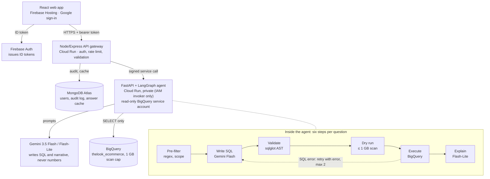

# 2 · Architecture & API Spec

Three deployables — React on Firebase Hosting, a Node gateway and a Python agent on Cloud Run — with the LLM boxed in by deterministic checks on both sides.

## At a glance

Only validated, cost-capped SELECT queries reach BigQuery.



The gateway owns users, limits and logging; the agent owns reasoning and BigQuery; a question blocked at pre-filter, validate or dry run never reaches execution.

## Components

| Component | Tech | Responsibility | Hosted on |
| --- | --- | --- | --- |
| Web app | React 18 + Vite, Tailwind, Recharts, Firebase JS SDK | Sign-in, ask box, answer card, trace panel, history, metrics page | Firebase Hosting |
| API gateway | Node 20, Express, helmet, express-rate-limit, zod, firebase-admin, mongoose, google-auth-library | Verify ID token, validate input, rate limit, answer cache, audit log, call agent | Cloud Run `insightpilot-api` (public) |
| Agent service | Python 3.12, FastAPI, LangGraph, google-genai, google-cloud-bigquery, sqlglot, pandas | Plan → SQL → validate → dry run → execute → facts → insight → chart | Cloud Run `insightpilot-agent` (private) |
| App database | MongoDB Atlas M0 | `users`, `queries`, `cache`, `eval_runs` | Atlas, region near `us-central1` |
| Warehouse | BigQuery | `bigquery-public-data.thelook_ecommerce` (US multi-region) | Google |
| LLM | Gemini via google-genai (AI Studio key or Vertex AI) | SQL generation, narrative | Google |
| Secrets | Secret Manager | Gemini key, Mongo URI | Google |
| Logs | Cloud Logging | JSON logs from both services | Google |

## Request flow

1. Browser signs in with Google through Firebase Auth and gets an ID token.
2. Browser `POST /api/ask` with `Authorization: Bearer <token>`.
3. Gateway verifies the token, validates the body with zod, checks the per-user rate limit.
4. Gateway hashes the normalized question; a cache hit returns the stored answer (status `cached`).
5. On a miss, gateway calls the agent with a Google-signed ID token (Cloud Run IAM) and a request ID.
6. Agent runs the graph below and returns answer, data, chart spec, SQL, trace and metrics.
7. Gateway writes the audit record and cache entry, then returns the response.

## Agent graph (LangGraph)

| Node | Implemented with | Output | On failure |
| --- | --- | --- | --- |
| `prefilter` | Regex + length rules (no LLM) | pass / `OUT_OF_SCOPE` / `UNSAFE_REQUEST` | Return `blocked` |
| `write_sql` | `gemini-3.5-flash`, structured JSON output | `{answerable, sql, tables, assumptions}` | `answerable=false` → `OUT_OF_SCOPE` |
| `validate_sql` | sqlglot AST rules (03) + LIMIT injection | safe SQL or violation list | Return `blocked` `UNSAFE_SQL` (no retry for safety violations) |
| `dry_run` | BigQuery `dry_run=True` | `total_bytes_processed` | Above cap → `COST_LIMIT`; syntax error → `write_sql` retry |
| `execute` | BigQuery job, `maximum_bytes_billed`, 30 s timeout, result cache on | rows (≤ 1000), job ID, bytes | Error → `write_sql` with error text, max 2 retries, then `SQL_FAILED` |
| `compute_facts` | pandas | row count, totals, top/bottom item, min/max, change % | Empty result → "no data" answer |
| `explain` | `gemini-3.5-flash-lite` + number-grounding check | 2–3 sentence insight | Regenerate once, then template sentence |
| `chart` | Rules on column types | `{type, x, y}` or `table` | Default to `table` |

### Graph state

```python
class AgentState(TypedDict):
    request_id: str
    question: str
    sql: str | None
    attempts: int                 # write_sql calls so far, max 3
    last_error: str | None        # fed back into write_sql on retry
    bytes_estimate: int | None
    bytes_processed: int | None
    job_id: str | None
    columns: list[dict]           # [{name, type}]
    rows: list[dict]
    facts: list[dict]             # [{label, value}] — the only numbers the insight may use
    insight: str | None
    chart: dict | None
    status: Literal["running", "answered", "blocked", "failed"]
    code: str | None              # error / block code
    trace: list[dict]             # [{step, status, ms, detail}]
    llm: dict                     # {calls, input_tokens, output_tokens}
```

### SQL prompt skeleton (`prompts/write_sql.v1.txt`)

```text
You write ONE BigQuery Standard SQL SELECT statement for the question.
Rules:
- Use only these tables, always fully qualified with backticks:
  {schema_ddl}            <- generated at startup, PII columns removed
- Never use columns not listed. Never write INSERT/UPDATE/DELETE/DDL.
- Revenue = SUM(order_items.sale_price) where order_items.status = 'Complete' unless asked otherwise.
- Use CURRENT_DATE() for relative dates. Add ORDER BY for rankings. LIMIT 1000 max.
- If the question is not answerable from these tables, return answerable=false.
Return JSON: {"answerable": bool, "sql": str, "tables": [str], "assumptions": [str]}
Examples: {3 few-shot pairs — never questions from the eval set}
{previous_error_block}    <- only on retry: last SQL + BigQuery error text
Question: {question}
```

## Data model (MongoDB)

```js
// users
{ _id: firebaseUid, email, displayName, role: "user"|"admin", createdAt, lastSeenAt }

// queries  — one per request, the audit trail
{ _id, requestId, uid, question, questionHash, status: "answered"|"cached"|"blocked"|"failed",
  code, sql, bqJobId, bytesEstimate, bytesProcessed, rowCount,
  columns, rowsPreview /* ≤ 50 rows */, facts, insight, chart,
  trace, attempts, llm: { model, calls, inputTokens, outputTokens },
  latencyMs, promptVersion, createdAt }
// indexes: { uid: 1, createdAt: -1 }, { questionHash: 1 }, { requestId: 1 } unique

// cache  — TTL 6 h
{ _id: sha256(normalizedQuestion + model + promptVersion), queryId, expiresAt }
// index: { expiresAt: 1 }, { expireAfterSeconds: 0 }

// eval_runs
{ _id, startedAt, model, promptVersion, n, executionAccuracy, validSqlRate,
  attackBlockRate, p50Ms, p95Ms, medianBytes, results: [ { qid, pass, ms, bytes, error } ] }
```

## API — gateway (public)

| Method | Path | Auth | Purpose |
| --- | --- | --- | --- |
| POST | `/api/ask` | User | Ask a question |
| GET | `/api/history?limit=20&before=<iso>` | User | My recent questions |
| GET | `/api/queries/:id` | User (owner) | Full stored answer |
| GET | `/api/metrics/eval/latest` | User | Latest eval run summary |
| GET | `/api/metrics/live` | User | Aggregates over the last 100 queries |
| POST | `/api/admin/eval/run` | Admin | Trigger eval run |
| GET | `/healthz` | None | Liveness |

**`POST /api/ask`** request: `{ "question": "Top 5 categories by revenue in the last 90 days" }`

200 response:

```json
{
  "queryId": "6717c2…",
  "status": "answered",
  "cached": false,
  "answer": {
    "insight": "Outerwear & Coats led revenue …",
    "facts": [{ "label": "Top category", "value": "Outerwear & Coats" }, { "label": "Top revenue (USD)", "value": 123456.78 }]
  },
  "data": { "columns": [{ "name": "category", "type": "STRING" }, { "name": "revenue", "type": "FLOAT64" }], "rows": [], "rowCount": 5, "truncated": false },
  "chart": { "type": "bar", "x": "category", "y": "revenue" },
  "sql": "SELECT …",
  "trace": [{ "step": "validate_sql", "status": "ok", "ms": 12, "detail": "1 statement, 2 tables, LIMIT 1000" }],
  "metrics": { "latencyMs": 6120, "bytesProcessed": 0, "llmCalls": 2, "inputTokens": 0, "outputTokens": 0 }
}
```

Values above are placeholders showing shape, not real results.

Blocked response (HTTP 422): `{ "status": "blocked", "code": "UNSAFE_SQL", "message": "Query references a restricted column (users.email).", "trace": […] }`

## API — agent (private)

| Method | Path | Body / purpose |
| --- | --- | --- |
| POST | `/v1/ask` | `{ question, uid, requestId }` → same payload as gateway minus `queryId`/`cached` |
| POST | `/v1/eval/run` | Runs golden set + attack set, returns summary |
| GET | `/healthz` | Liveness + schema cache loaded flag |

## Error codes

| Code | HTTP | Meaning |
| --- | --- | --- |
| `AUTH_REQUIRED` | 401 | Missing or invalid ID token |
| `FORBIDDEN` | 403 | Not owner / not admin |
| `VALIDATION_ERROR` | 400 | Bad request body |
| `RATE_LIMITED` | 429 | Per-user limit hit; `Retry-After` header set |
| `OUT_OF_SCOPE` | 422 | Not answerable from the dataset |
| `UNSAFE_REQUEST` | 422 | Pre-filter caught a destructive or injection request |
| `UNSAFE_SQL` | 422 | Validator rejected the generated SQL |
| `COST_LIMIT` | 422 | Dry run above 1 GB |
| `SQL_FAILED` | 502 | Still failing after 2 retries |
| `LLM_UNAVAILABLE` | 503 | Gemini quota or outage |
| `TIMEOUT` | 504 | Request exceeded 45 s |

## Repo layout

```text
insightpilot/
  web/                 React + Vite
    src/pages/  Ask.jsx  History.jsx  Metrics.jsx
    src/components/  AnswerCard.jsx  TracePanel.jsx  ResultChart.jsx  ResultTable.jsx
    src/lib/  firebase.js  api.js
  api/                 Node/Express gateway
    src/index.js
    src/middleware/  auth.js  rateLimit.js  validate.js  errors.js
    src/routes/  ask.js  history.js  metrics.js  admin.js
    src/models/  User.js  Query.js  Cache.js  EvalRun.js
    src/lib/  agentClient.js  hash.js  logger.js
    Dockerfile
  agent/               FastAPI + LangGraph
    app/main.py  app/graph.py  app/config.py  app/llm.py  app/bq.py  app/schema_cache.py
    app/nodes/  prefilter.py  write_sql.py  validate_sql.py  dry_run.py  execute.py  facts.py  explain.py  chart.py
    app/prompts/  write_sql.v1.txt  explain.v1.txt
    eval/  golden.jsonl  attacks.jsonl  run_eval.py
    tests/  test_validator.py  test_facts.py  test_grounding.py
    Dockerfile
  docs/                these docs (feed to your coding agent)
  README.md            setup, architecture, disclosure
```

## Environment variables

| Variable | Service | Example | Secret? |
| --- | --- | --- | --- |
| `GEMINI_API_KEY` | agent | from AI Studio | Yes |
| `GOOGLE_GENAI_USE_VERTEXAI` | agent | `false` (set `true` + project/location to use Vertex AI) | No |
| `GEMINI_MODEL_SQL` | agent | `gemini-3.5-flash` | No |
| `GEMINI_MODEL_LITE` | agent | `gemini-3.5-flash-lite` | No |
| `GCP_PROJECT` | agent | your project ID | No |
| `BQ_DATASET` | agent | `bigquery-public-data.thelook_ecommerce` | No |
| `BQ_MAX_BYTES` | agent | `1000000000` | No |
| `PROMPT_VERSION` | agent, api | `v1` | No |
| `MONGO_URI` | api | Atlas SRV string | Yes |
| `AGENT_URL` | api | `https://insightpilot-agent-…run.app` | No |
| `CORS_ORIGINS` | api | `https://<project>.web.app` | No |
| `FIREBASE_PROJECT_ID` | api | your project ID | No |
| `VITE_FIREBASE_*` | web | Firebase web config (public by design) | No |
| `VITE_API_URL` | web | gateway URL | No |
